# Atelier 6 — DTO, validation, gestion centralisée des erreurs, services d'affectation

## 1. Utilisation des DTO

Les contrôleurs ne manipulent plus les entités JPA : ils reçoivent des **DTO de saisie** (`...RequestDTO`)
et renvoient des **DTO de réponse** (`...DTO`). Les annotations Jackson (`@JsonIgnore`,
`@JsonManagedReference`...) ont donc été retirées des entités : elles ne servaient qu'à éviter les
boucles de sérialisation.

| Entité | DTO de saisie (`dto`) | DTO de réponse (`dto`) | Mapper (`mapper`) |
|---|---|---|---|
| Agence | `AgenceRequestDTO` | `AgenceDTO` | `AgenceMapper` |
| Employe | `EmployeRequestDTO` | `EmployeDTO` (+ idAgence, nomAgence) | `EmployeMapper` |
| Vehicule | `VehiculeRequestDTO` | `VehiculeDTO` (+ agence réduite, équipements, nbMaintenances) | `VehiculeMapper` |
| Equipement | `EquipementRequestDTO` | `EquipementDTO` | `EquipementMapper` |
| Client | `ClientRequestDTO` | `ClientDTO` | `ClientMapper` |
| Reservation | `ReservationRequestDTO`, `ReservationWithContratRequestDTO` | `ReservationResponseDTO` (idClient, nomClient, idVehicule, immatriculation, idContrat) | `ReservationMapper` |
| Contrat | `ContratRequestDTO`, `ContratInfoRequestDTO` | `ContratDTO` (+ paiements) | `ContratMapper` |
| Paiement | `PaiementRequestDTO` (saisi via le contrat) | `PaiementDTO` | `PaiementMapper` |
| Maintenance | `MaintenanceRequestDTO` | `MaintenanceDTO` (+ idVehicule, immatriculation) | `MaintenanceMapper` |

Principes :

- Les relations sont échangées **par identifiant** (`idClient`, `idVehicule`, `idAgence`, `idReservation`...)
  au lieu d'objets imbriqués : les réponses sont plus légères, sans boucle ni proxy Hibernate.
- Les **mappers** (`@Component`) ne font que la conversion entité ⇄ DTO. Ce sont les **services** qui retrouvent
  les entités liées via les repositories (`ResourceNotFoundException` → 404 si l'identifiant n'existe pas).
- Les **services renvoient des DTO** (jamais d'entités) et sont `@Transactional` : le mapping se fait dans la transaction.
- Les **contrôleurs** n'exposent que les services : aucune logique métier, aucun `try/catch`.

Exemple (création d'une réservation) :

```json
POST /api/reservations
{ "dateDebut": "2026-11-02", "dateFin": "2026-11-06", "statut": "CONFIRMEE", "idClient": 1, "idVehicule": 1 }

201 Created
{ "idReservation": 7, "dateDebut": "2026-11-02", "dateFin": "2026-11-06", "statut": "CONFIRMEE",
  "idClient": 1, "nomClient": "Amine Trabelsi", "idVehicule": 1, "immatriculation": "TU-1234", "idContrat": null }
```

## 2. Validation des données (Bean Validation)

La dépendance `spring-boot-starter-validation` est dans le `pom.xml`. Les contrôles sont portés par les DTO
de saisie ; les contrôleurs utilisent `@Valid @RequestBody`.

| Contrainte | Où |
|---|---|
| `@NotBlank` + `@Size(max)` alignés sur les colonnes | nom/ville agence, nom/prénom employé et client, libellé, immatriculation, marque, modèle, numéro de permis |
| `@Email` | email du client |
| `@Pattern` (chiffres, espaces, `+`, `( )`, `-`) + `@Size(max = 20)` | téléphone (agence, client) |
| `@NotNull` sur les énumérations | rôle, catégorie, statut véhicule, statut réservation, mode de paiement |
| `@PositiveOrZero` + `@Digits(8, 2)` | tarif journalier, montant total du contrat |
| `@Positive` + `@Digits(8, 2)` | montant d'un paiement |
| `@NotNull` sur les identifiants de relation | idClient, idVehicule, idReservation |
| `@Valid` en cascade | `paiements` du contrat, `contrat` de `ReservationWithContratRequestDTO` |
| `@AssertTrue` (contrôle croisé `isPeriodeValide`) | dateFin ≥ dateDebut (réservation, maintenance, réservation + contrat) |
| `@NotBlank` / `@Size` sur `@RequestParam` (contrôleurs `@Validated`) | paramètres des services d'affectation |

## 3. Gestion centralisée des erreurs

Une seule classe, `exception.GlobalExceptionHandler` (`@RestControllerAdvice`), traduit toutes les exceptions
de tous les contrôleurs en un corps JSON uniforme (`exception.ErrorResponse`) :

```json
{ "timestamp": "2026-11-19T10:12:03Z", "status": 400, "error": "Bad Request",
  "message": "Les donnees saisies sont invalides", "path": "/api/clients",
  "fieldErrors": { "email": "L'email n'est pas valide" } }
```

| Exception | Statut | Cas |
|---|---|---|
| `ResourceNotFoundException` | 404 | identifiant, client, véhicule, immatriculation... introuvable |
| `MethodArgumentNotValidException` | 400 | `@Valid` sur un DTO (détail dans `fieldErrors`) |
| `ConstraintViolationException` | 400 | contraintes sur `@RequestParam` |
| `HttpMessageNotReadableException` | 400 | JSON mal formé, date illisible, valeur d'énumération inconnue |
| `MethodArgumentTypeMismatchException`, `MissingServletRequestParameterException` | 400 | paramètre d'URL du mauvais type ou manquant |
| `IllegalArgumentException` | 400 | règle de gestion violée dans un service |
| `NoResourceFoundException` | 404 | URL inconnue |
| `HttpRequestMethodNotSupportedException` | 405 | ex. `POST /api/paiements` |
| `HttpMediaTypeNotSupportedException` | 415 | `Content-Type` autre que JSON |
| `DataIntegrityViolationException` | 409 | unicité (immatriculation, email, permis) ou ligne référencée |
| `Exception` | 500 | erreur imprévue (détail uniquement dans les logs) |

## 4. Les 5 services d'affectation

Signatures respectées ; chaque service renvoie un DTO et les contrôleurs se contentent de les exposer.

| Service (interface) | Endpoint | Comportement |
|---|---|---|
| `IReservationService.affecterReservationAClient(Long idReservation, String nom, String prenom)` → `ReservationResponseDTO` | `PUT /api/reservations/{idReservation}/affecter-client?nom=..&prenom=..` | recherche le client par nom + prénom (sans tenir compte de la casse), l'affecte à la réservation. 404 si réservation ou client introuvable |
| `IVehiculeService.affecterVehiculeAEquipement(Long idVehicule, Long idEquipement)` → `VehiculeDTO` | `PUT /api/vehicules/{idVehicule}/equipements/{idEquipement}` | ajoute l'équipement au véhicule, sans doublon (appel répété sans effet) |
| `IVehiculeService.affecterMaintenanceAvehicule(String description, String immatriculation)` → `VehiculeDTO` | `POST /api/vehicules/affecter-maintenance?description=..&immatriculation=..` | crée une maintenance (début = date du jour) pour le véhicule et le passe au statut `MAINTENANCE` |
| `IContratService.affecterContratAReservation(LocalDate dateSignature, LocalDate dateDebut, LocalDate dateFin)` → `ContratDTO` | `POST /api/contrats/affecter-reservation?dateSignature=..&dateDebut=..&dateFin=..` | prend la réservation sans contrat dont la période est dateDebut → dateFin (la plus ancienne s'il y en a plusieurs), crée le contrat signé (valide) avec montant = nombre de jours × tarif journalier |
| `IReservationService.creerReservationEtContratAssocie(ReservationWithContratRequestDTO)` → `ReservationResponseDTO` | `POST /api/reservations/avec-contrat` | crée la réservation et son contrat dans **une seule transaction** (rollback si le contrat échoue). Statut par défaut `EN_ATTENTE`, montant calculé s'il est omis |

Exemple pour le service 5 :

```json
POST /api/reservations/avec-contrat
{ "dateDebut": "2028-04-01", "dateFin": "2028-04-04", "statut": "CONFIRMEE", "idClient": 1, "idVehicule": 1,
  "contrat": { "dateSignature": "2028-03-25", "valide": true } }
```

Nouvelles méthodes de repository : `IVehiculeRepository.findByImmatriculation`,
`IClientRepository.findFirstByNomIgnoreCaseAndPrenomIgnoreCase`,
`IReservationRepository.findSansContratByPeriode` (requête JPQL).

## 5. Tests et captures d'écran

La collection `postman/AutoLoc.postman_collection.json` est mise à jour (corps de requête avec identifiants) et
complétée par deux dossiers : **Validation et erreurs (Atelier 6)** et **Services d'affectation (Atelier 6)**.
Exécution du Runner Postman (environnement `local`) : **171 tests réussis, 0 échec, 0 erreur**.

### 5.1 Exécution de la collection Postman

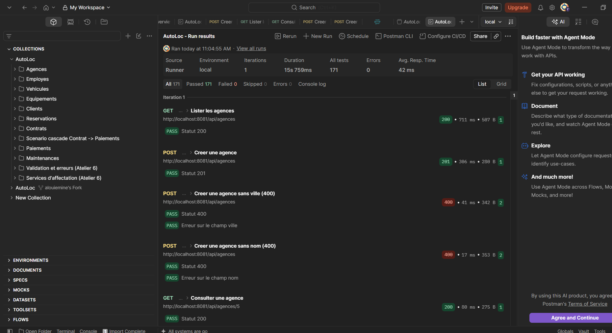

### 5.2 Réponse sous forme de DTO

`GET /api/reservations/{id}` : le client et le véhicule sont réduits à leur identifiant et à quelques champs utiles
(`idClient`, `nomClient`, `idVehicule`, `immatriculation`, `idContrat`), sans objets imbriqués.

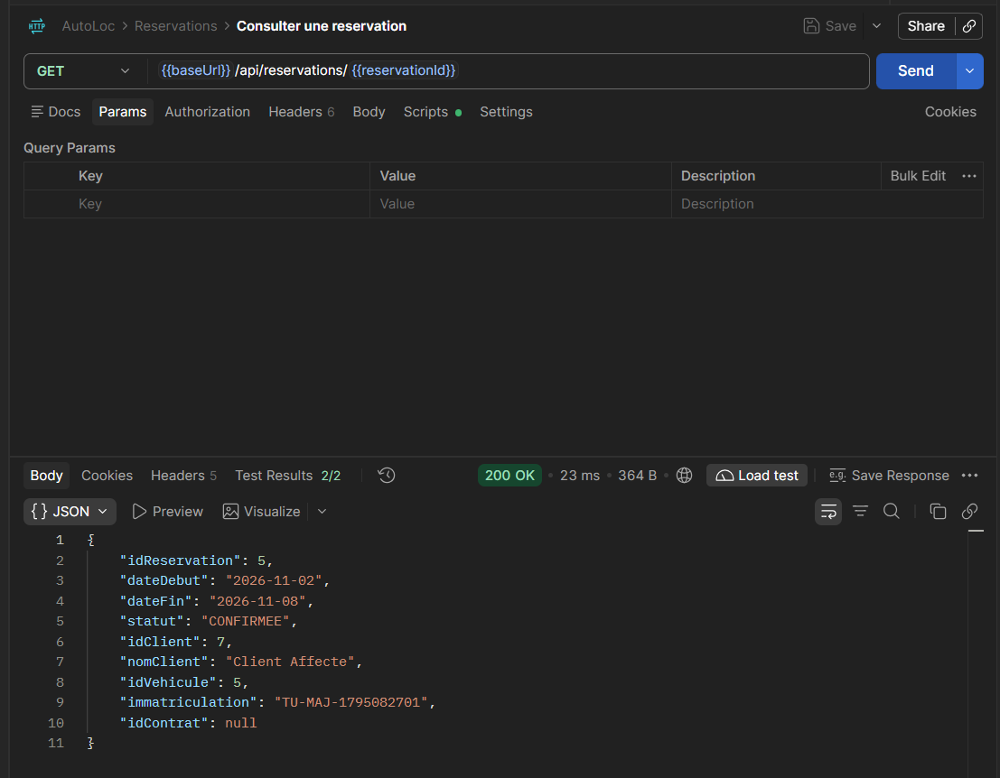

`POST /api/vehicules` : `VehiculeDTO` avec l'agence réduite (`idAgence`, `nomAgence`), la liste des équipements et
le nombre de maintenances.

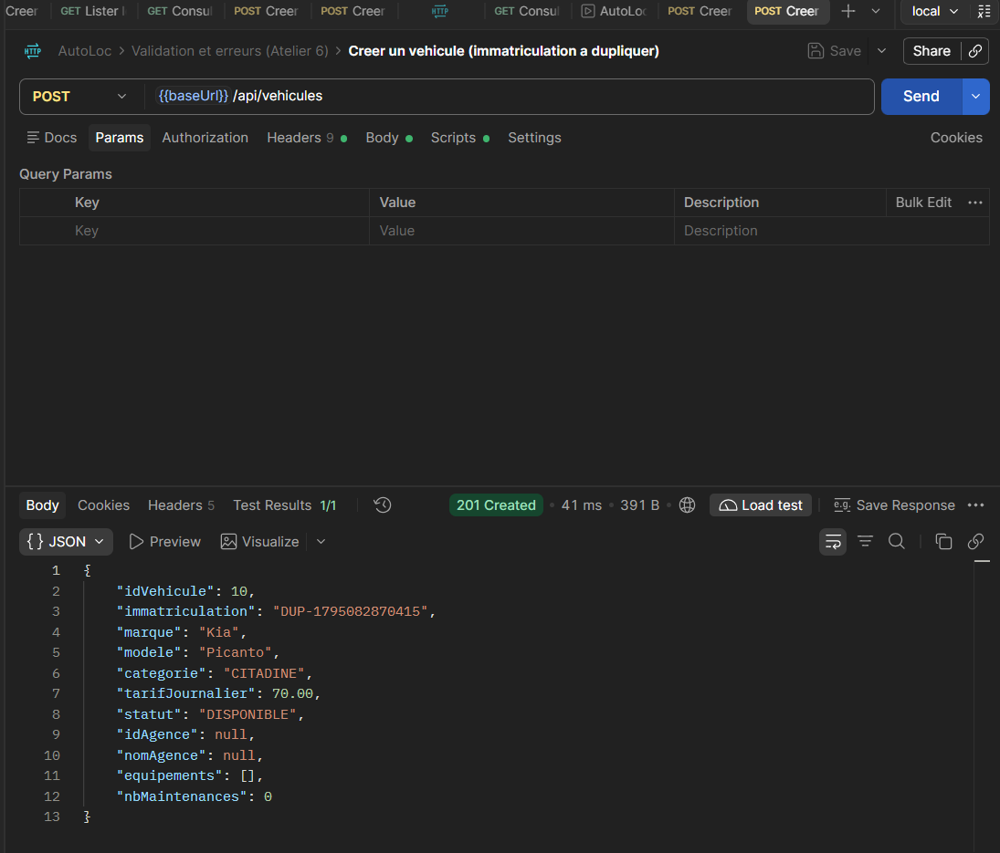

### 5.3 Validation et gestion centralisée des erreurs

Erreur de validation (400) : le champ fautif et son message sont dans `fieldErrors`.

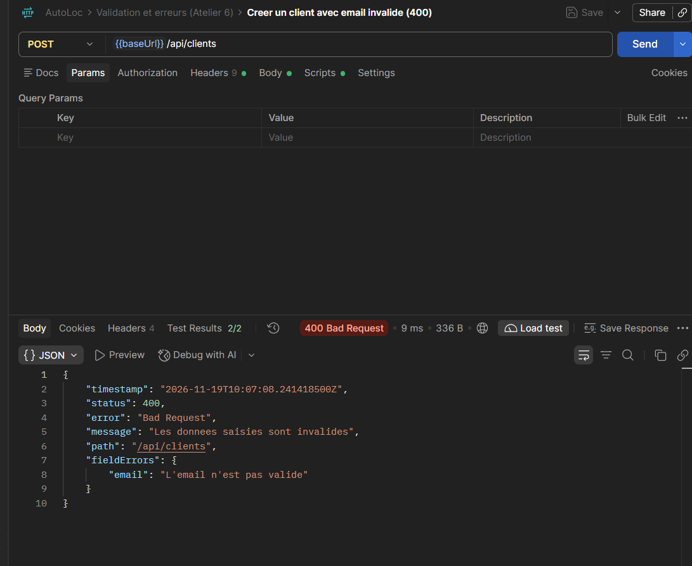

Ressource introuvable (404) : même format d'erreur uniforme (`timestamp`, `status`, `error`, `message`, `path`).

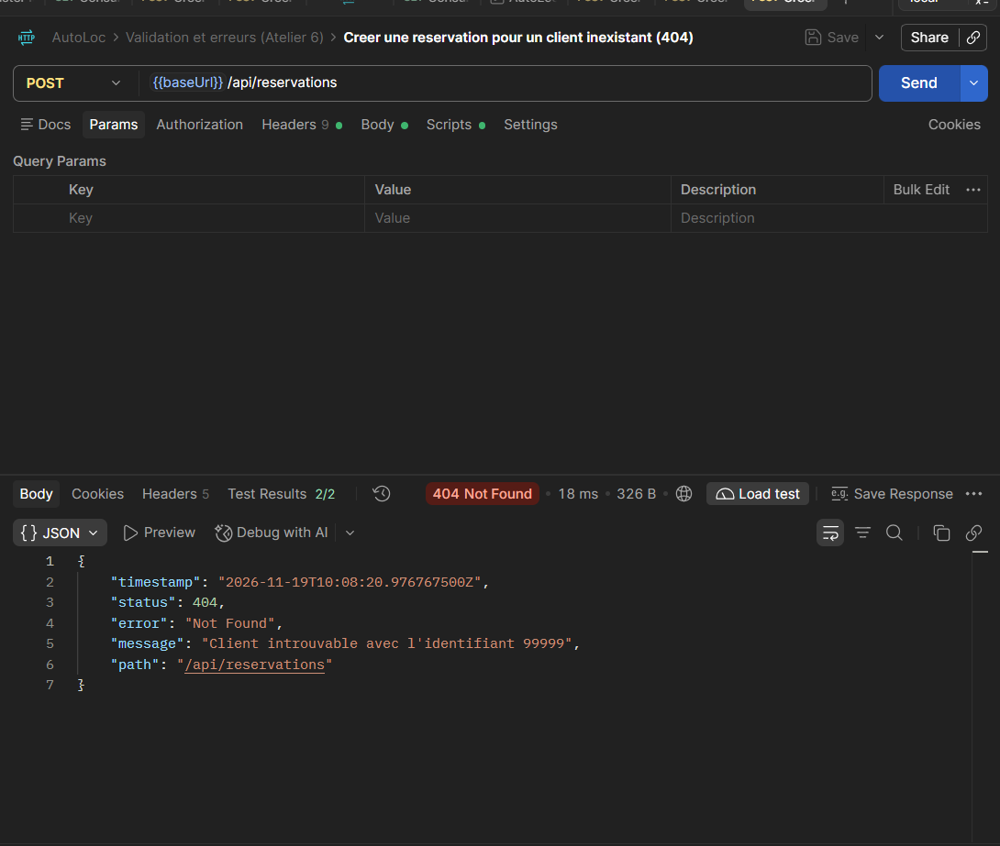

### 5.4 Documentation Swagger

Le service `POST /reservations/avec-contrat` et le schéma du DTO de saisie `ReservationWithContratRequestDTO`.

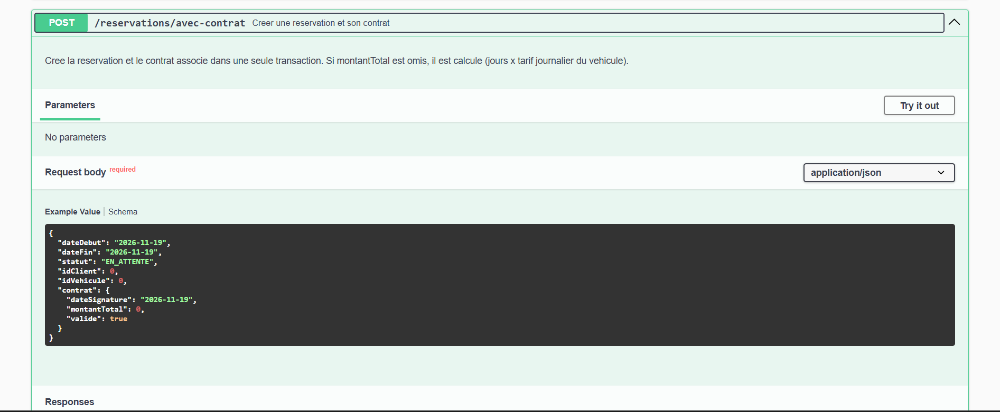

### 5.5 Les 5 services d'affectation

1. `affecterReservationAClient` : `PUT /api/reservations/{idReservation}/affecter-client?nom=Affecte&prenom=Client`.
   La réservation est maintenant rattachée au client trouvé par nom et prénom (`idClient`, `nomClient`).

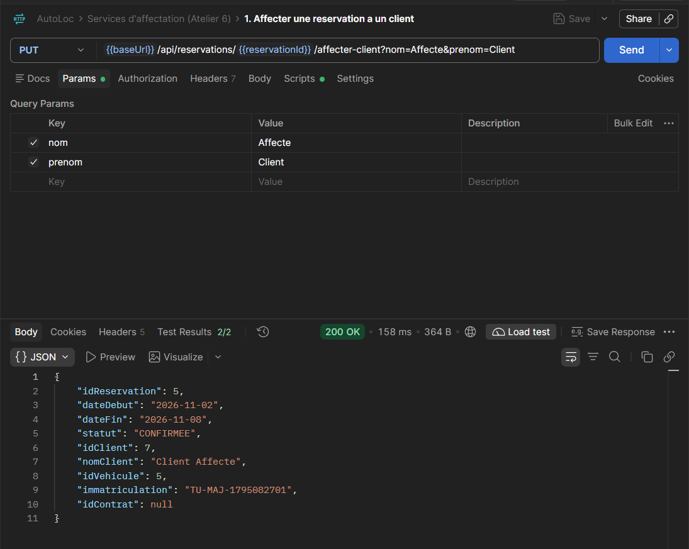

2. `affecterVehiculeAEquipement` : `PUT /api/vehicules/{idVehicule}/equipements/{idEquipement}`.
   L'équipement « Siege bebe » apparaît dans la liste `equipements` du véhicule.

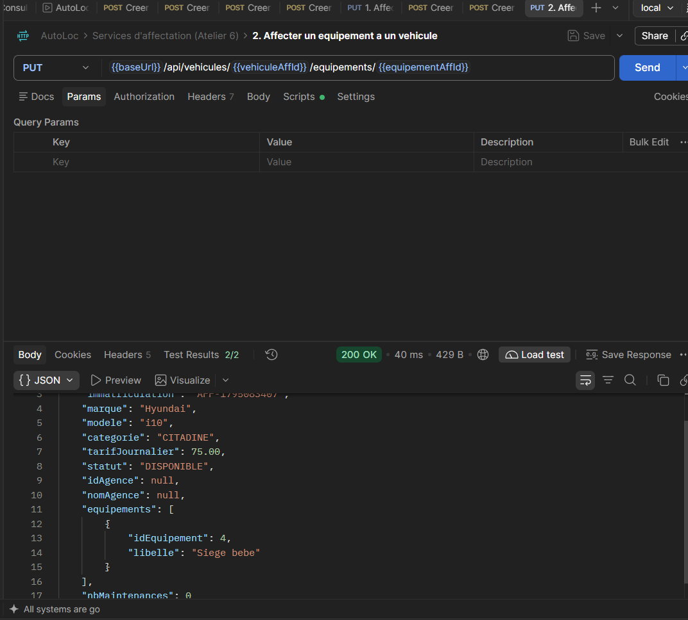

3. `affecterMaintenanceAvehicule` : `POST /api/vehicules/affecter-maintenance?description=...&immatriculation=...`.
   Le véhicule passe au statut `MAINTENANCE` et une maintenance est créée.

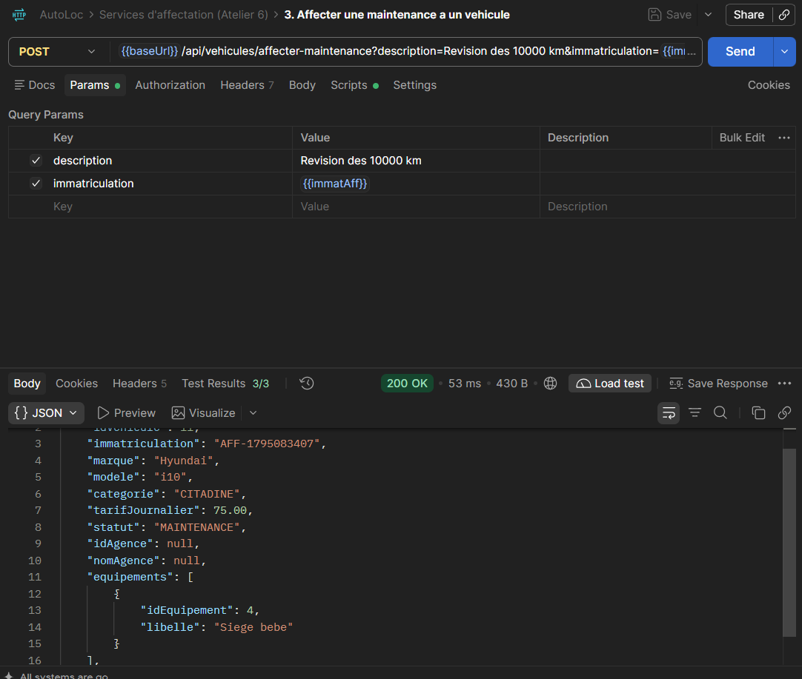

4. `affecterContratAReservation` : `POST /api/contrats/affecter-reservation?dateSignature=...&dateDebut=...&dateFin=...`.
   Le contrat est créé (201) pour la réservation de la période ; montant = 4 jours × 75 = 300.00.

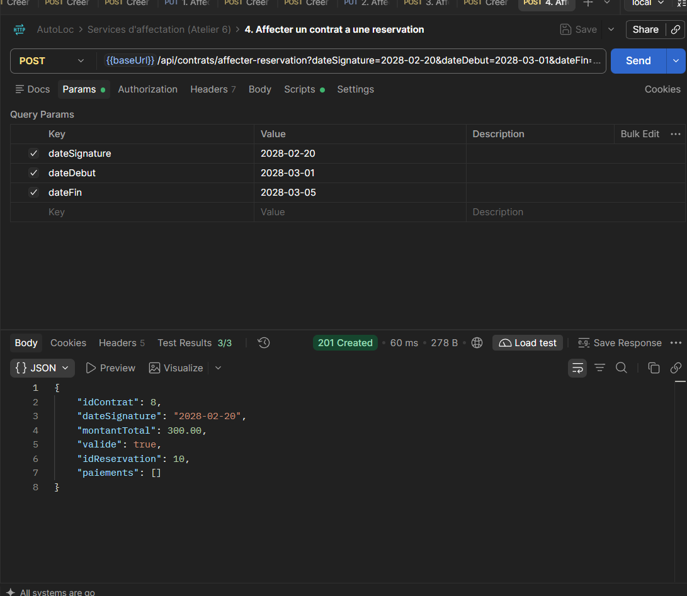

5. `creerReservationEtContratAssocie` : `POST /api/reservations/avec-contrat`.
   La réservation et son contrat sont créés en une seule opération (`idReservation` et `idContrat` renseignés).

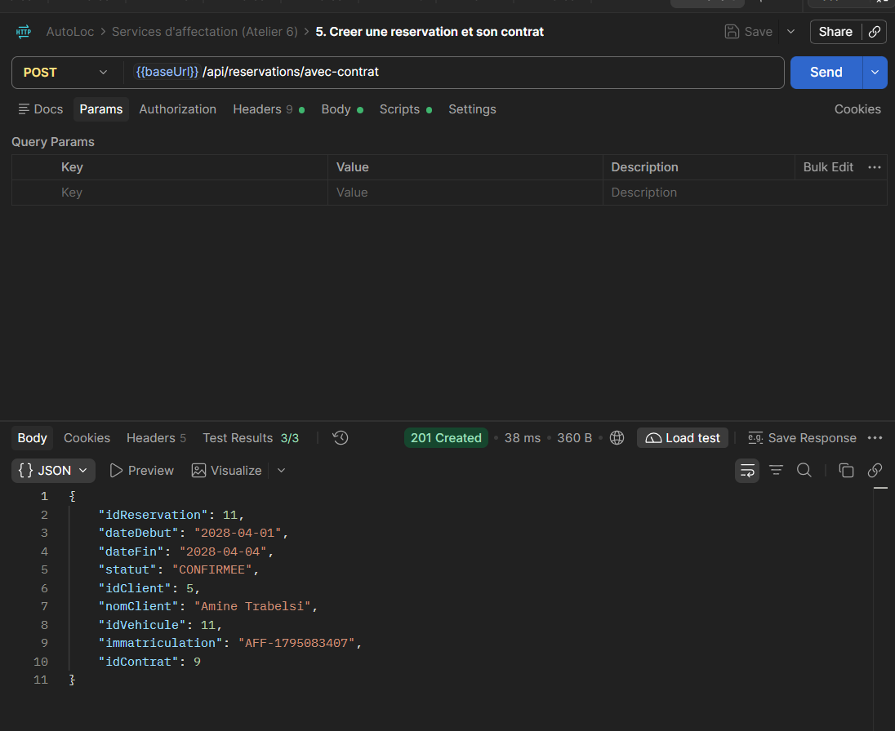

